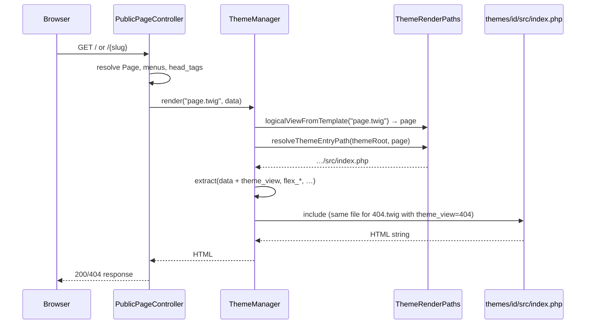

# MVC in PHP themes

Flex CMS **owns public URL routing** (`PublicPageController` resolves the slug, loads the `Page` model, applies `public.head` / `public.title`, then renders the active theme). Themes **do not** register HTTP routes on the platform router.

## Public render flow (PHP theme)



Important details:

| Step | Code | Note |
|------|------|------|
| Template name | `page.twig` / `404.twig` | Historical Twig names; PHP themes do not load these files. |
| Logical view | `ThemeRenderPaths::logicalViewFromTemplate()` | Becomes `$theme_view` in the entry scope. |
| Entry file | `src/index.php` (preferred) | One bootstrap for all views when present. |
| Fallback | `ThemeRenderPaths::legacyPhpTemplateCandidates()` | Per-view `pages/{view}/index.php`, deprecated `page.php`. |
| Validation | `ThemeManager::themeHasRenderEntry()` | True if **page** or **404** can be resolved (same rules as runtime). |

404 responses use the same path with `render('404.twig', …)` and `$theme_view === '404'` (plus `isErrorPage` in scope since 0.1.68).

Themes **can** use MVC inside the render entry:

| Layer | Role in a theme |
|--------|------------------|
| **Entry** | `src/index.php` (or root `index.php`) — platform always includes the theme index; `$theme_view` (`page`, `404`, …) selects the screen |
| **Controller** | Builds view data from `$page`, menus, `$flex_theme_content()`, etc. |
| **View** | PHP templates / partials under `src/View/templates/` (or legacy theme paths) |
| **Model** | Optional wrappers around page arrays, theme content, or theme services |

Platform injects variables via `extract()` before the entry runs. Since 0.1.66+ **`theme_view`** is set (`page`, `404`, …) so one bootstrap can dispatch internally.

## Internal routing (optional)

Use **League Route** (or similar) **inside the theme** to map **page slug** (or path) to a controller — not to compete with CMS URLs. Example: slug `home` → `HomeController`, everything else → `PageController`.

Install theme dependencies from the theme directory:

```bash
cd themes/your-theme && composer install --no-dev
```

Ship `vendor/` with the theme package or run `composer install` after theme install.

## Constraints

- No direct access to Flex DI container; use injected variables and `flex_*` helpers only.
- Keep entry files small so platform upgrades stay safe.
- Autoload theme classes from `bootstrap.php` or theme `vendor/autoload.php`.

Reference: `themes/kriskata-corporate`.

## Code-in-`src/` layout

Theme authors may keep **all executable code and static front-end assets** under `themes/{id}/src/`, including a single **`src/index.php`** entry that reads `$theme_view` (`page`, `404`, …). Only configuration (`theme.json`, `fields/*.json`, optional `composer.json`) stays outside `src/`.

Flex resolves PHP entries via `ThemeRenderPaths`: **`src/index.php` or `index.php` only** when present (all public views). Legacy fallbacks: `pages/{view}/index.php`, then deprecated `page.php`. Static files use `ThemeAssetPaths` (`src/assets/`).
